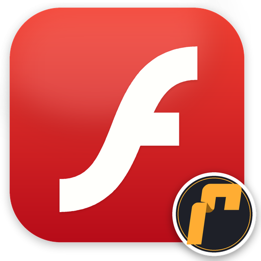
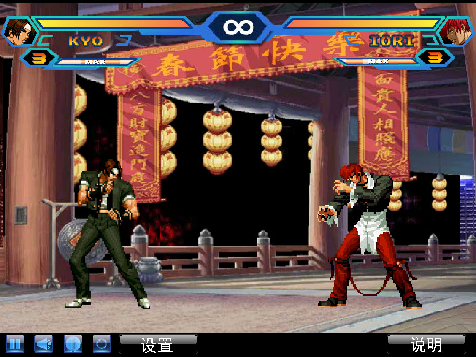
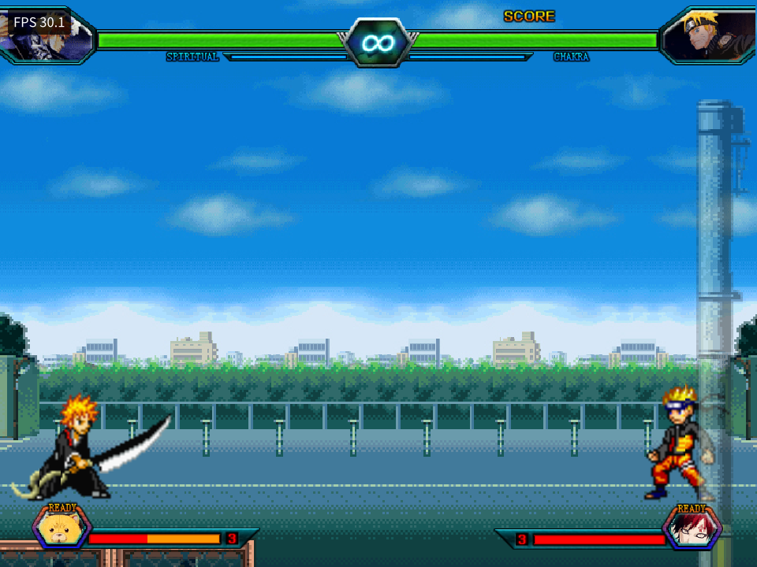

# Ruffle Flash

A Ruffle-based Flash player for **Miniloong Pocket 1 / leafOS**.

[简体中文](README.md) · **English**

[Download](https://github.com/changdy/ruffle-leafos/releases) · [User guide](ruffle-leafos/README.en.md) · [Documentation](ruffle-leafos/docs/README.md) · [Report an issue](https://github.com/changdy/ruffle-leafos/issues)

| The King of Fighters Wing 1.91 | Bleach vs Naruto 3.3 |
| --- | --- |
|  |  |

This is a development preview. Device testing to date used Leaf 0.13.0. Compatibility and performance vary by game. [Version and device test coverage](ruffle-leafos/docs/progress.md)

## Quick start

1. Download `ruffle-leafos-<version>.zip`. [Releases](https://github.com/changdy/ruffle-leafos/releases)
2. Extract the ZIP and merge `Apps/`, `Roms/` and `Images/` into the root of the system SD card.
3. Refresh the Leaf game list and launch a game from **Flash**. Tap the physical **M** button to open the pause menu.

The main ZIP includes English Bloxorz and a diagnostic demo. The optional collection contains customized editions of KOF and two Bleach vs Naruto games. You can add your own SWFs or game ZIPs. [Installation, upgrades and adding games](ruffle-leafos/README.en.md#installing-and-upgrading)

## Handheld features

- Map buttons to keyboard keys, shortcuts or mouse actions in ten profiles for each game. Use the stick as a pointer, drag with a shortcut, or hold a button for turbo.
- Keep five progress slots for games with native saves. Manage progress and controls from Apps.
- Save screenshots or game covers, adjust the display, or switch interface languages from the pause menu. Use the on-screen keyboard with standard game text fields. [Handheld controls](ruffle-leafos/README.en.md#everyday-controls)

The images above were captured on Pocket1. [Screenshot sources](ruffle-leafos/docs/images/README.md)

Thanks to Ruffle, aweigit/ruffle-miyooflip and the Leaf / Jawaka communities. New project code is MIT-licensed. Game assets belong to their respective rights holders. [Project license](ruffle-leafos/adapter/LICENSE) · [Third-party notices](ruffle-leafos/docs/THIRD_PARTY.md)
