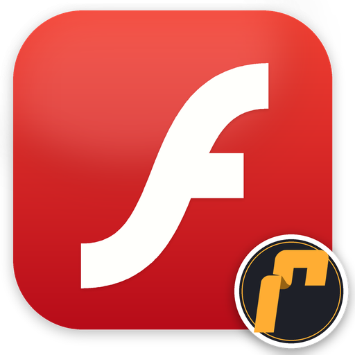
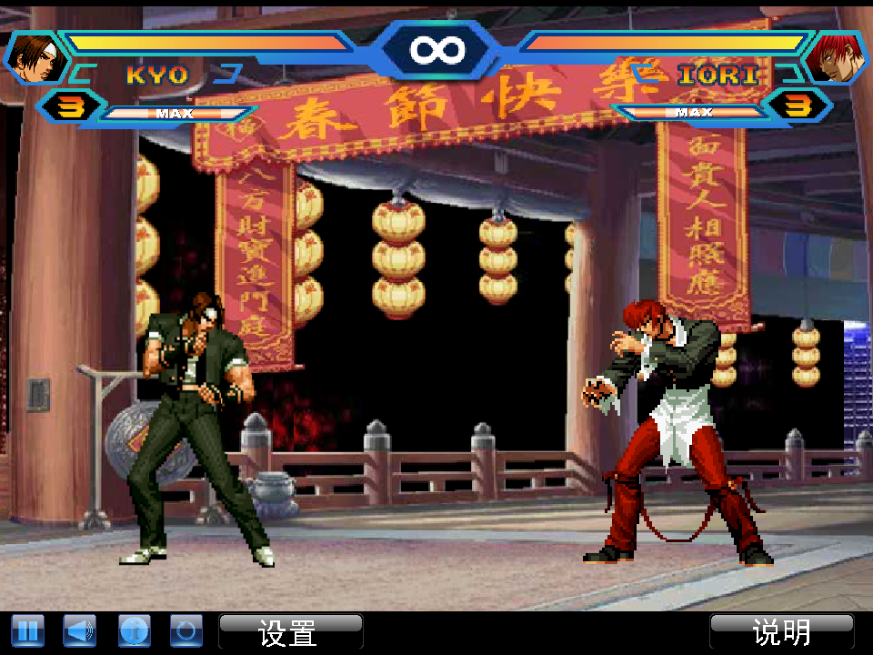
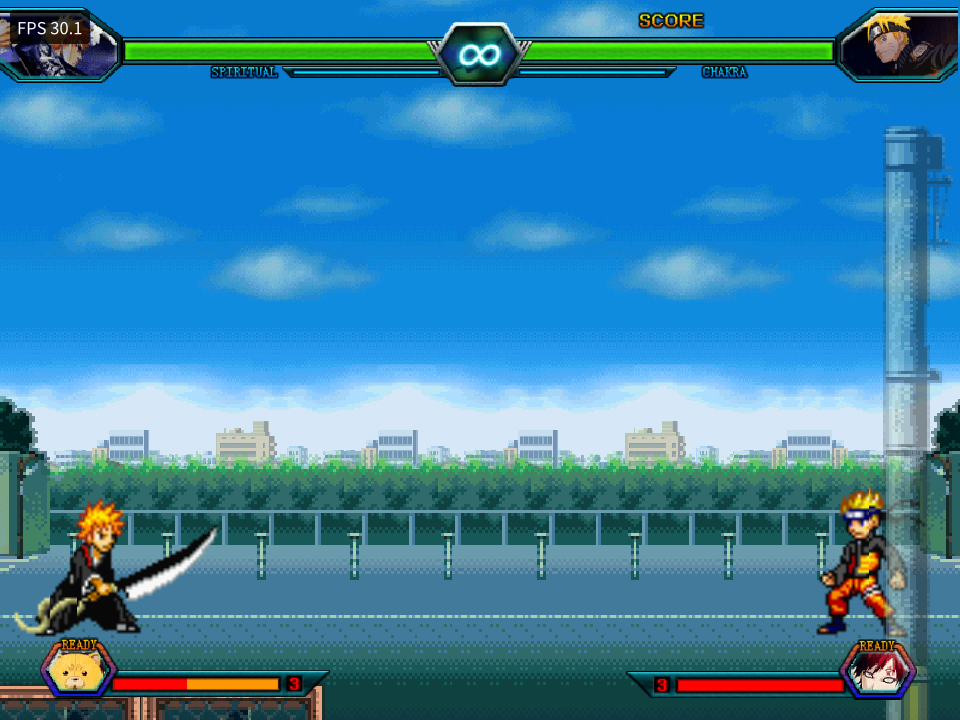
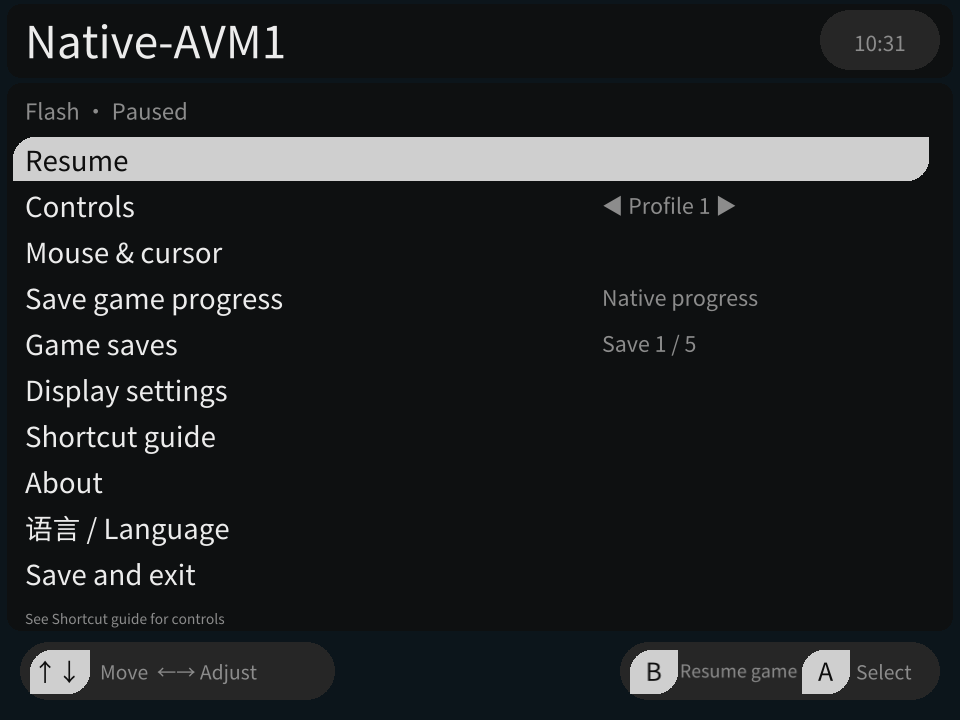

<div align="center">



# Ruffle Flash

**Bring your favorite Flash games to your pocket.**

A Flash player built for leafOS on the Miniloong Pocket 1, powered by Ruffle.

[简体中文](README.md) · **English**

[Download](https://github.com/changdy/ruffle-leafos/releases) · [User guide](ruffle-leafos/README.en.md) · [Report an issue](https://github.com/changdy/ruffle-leafos/issues)

</div>

| The King of Fighters Wing 1.91 | Bleach vs Naruto 3.3 |
| --- | --- |
|  |  |

**Current version: 0.8.3 development preview.** Currently supports **Miniloong Pocket 1 / leafOS** only, with device checks on Leaf 0.13.0. Compatibility and performance vary by game, and development is ongoing.

## Made for handheld play

Choose a game from Leaf’s **Flash category**, play with the handheld controls, and tap the **M menu button** whenever you need to pause or change a setting.

| Feature | What you can do |
| --- | --- |
| Custom controls | Save **10 profiles per game**, map keyboard keys, key combinations or mouse actions, and switch profiles while playing |
| Turbo buttons | Set individual buttons to repeat at **5 / 10 / 15 presses per second** while held |
| Mouse controls | Move with the stick, click with a stick press, drag, adjust speed and customize the cursor |
| Five progress slots | Keep **5 separate sets of in-game progress** for games with native saving, and copy progress between slots |
| Screenshots and covers | Save a clean game image or use the current frame as its Leaf cover |
| On-screen keyboard | Click a game text field and enter letters, numbers and symbols with the handheld controls |
| Display and language | Adjust scaling, Flash quality and the FPS counter; switch between Simplified Chinese and English |
| Data manager | Manage each game’s progress and control profiles from Apps, and clean up data you no longer need |

## Get started in three steps

1. **Download.** Open [Releases](https://github.com/changdy/ruffle-leafos/releases) and download the `ruffle-leafos-<version>.zip` installation archive.
2. **Copy.** Extract it and copy `Apps/`, `Roms/` and `Images/` into the **root of the system SD card**, merging existing folders. Before upgrading, exit the player normally and back up the previous installation and user data.
3. **Play.** Refresh the game list in Leaf, open the **Flash** category and choose a game. If asked for an emulator, choose **Ruffle Flash**.

The result should look like this. Do not add an extra version folder around these directories:

```text
System SD card/
├─ Apps/mlp1/RuffleProbe.pak/   ← Player and Flash Data Manager
├─ Roms/flash/                 ← Flash games (.swf)
└─ Images/flash/               ← Game covers
```

The current packaging process includes custom editions of *The King of Fighters Wing 1.91* and *Bleach vs Naruto 3.3*. Choose the main SWF whose filename contains **`-定制版`**. Keep Bleach vs Naruto’s `assets/` folder beside its main file; the resource SWFs inside it are not game entry points. Older archives may contain different games. See [bundled game details](ruffle-leafos/games/README.md) (Chinese).

To add your own games, put `.swf` files in `Roms/flash/`. Keep the full folder structure for games with external resources. [Adding games and covers →](ruffle-leafos/README.en.md#adding-games-and-covers)

## Essential controls

**M is the physical menu button. For a shortcut, hold M first, then press the other button.**

| Action | Controls |
| --- | --- |
| Pause, adjust settings or exit | Tap **M**; choose **Save and exit** to return to Leaf |
| Navigate menus | D-pad to select, **A** to confirm, **B** to go back; B resumes play from the pause menu |
| Use the mouse with a default profile | Move the stick; press it for a left click |
| Switch control profiles | **M + A / B**: previous / next, skipping empty profiles |
| Drag | **M + D-pad Down** toggles holding the left mouse button |
| Adjust sound | Use the physical volume buttons |

Games use different keys. If a game does not respond, check **M → Controls** first. [Full controls guide →](ruffle-leafos/README.en.md#everyday-controls)

## A look inside

| Ten control profiles for each game | Enter names and text with the handheld |
| --- | --- |
|  |  |
| **Screenshots: save a photo or make a cover** | **Apps: manage your game data** |
|  |  |
| **Pause to adjust your settings** | **Five separate slots for in-game progress** |
|  |  |

These are Pocket1 device captures from October 25–31, 2026, showing different development previews, languages and Leaf themes. Some labels have since changed; follow the current guide. Keyboard captures use test input content. [Screenshot sources](ruffle-leafos/docs/images/README.md)

## Before you play

- **Progress relies on the game’s own saving system.** The five slots store native game data, rather than an instant snapshot of the running game. Use the game’s save function first.
- **Compatibility is still improving.** Some games may have graphics, audio or runtime problems; larger games may run slowly. Screenshots do not establish complete playthrough, all-character or long-session compatibility.
- **OpenGL ES is the default.** You can try Vulkan in Display settings, but it is experimental and may not be faster.
- **The on-screen keyboard has no Chinese Pinyin input method yet.** Changing the interface language does not translate the game itself.

## Find out more

[English user guide](ruffle-leafos/README.en.md) · [中文使用指南](ruffle-leafos/README.md) · [Frequently asked questions](ruffle-leafos/README.en.md#frequently-asked-questions)

Found a problem? [Open an issue](https://github.com/changdy/ruffle-leafos/issues) with the game name, player and Leaf versions, and steps to reproduce it. Screenshots help.

Development resources (Chinese): [Progress and validation](ruffle-leafos/docs/progress.md) · [Implementation and builds](ruffle-leafos/docs/implementation.md) · [Documentation index](ruffle-leafos/docs/README.md)

## Credits and licenses

Thanks to [Ruffle](https://github.com/ruffle-rs/ruffle), [aweigit/ruffle-miyooflip](https://github.com/aweigit/ruffle-miyooflip) and the Leaf / Jawaka communities. Ruffle and the public frontend baseline use MIT / Apache-2.0; new project code uses [MIT](ruffle-leafos/adapter/LICENSE). See [third-party notices](ruffle-leafos/docs/THIRD_PARTY.md) for dependencies. Bundled games and their assets belong to their respective creators or rights holders and are not covered by the project’s code licenses.
