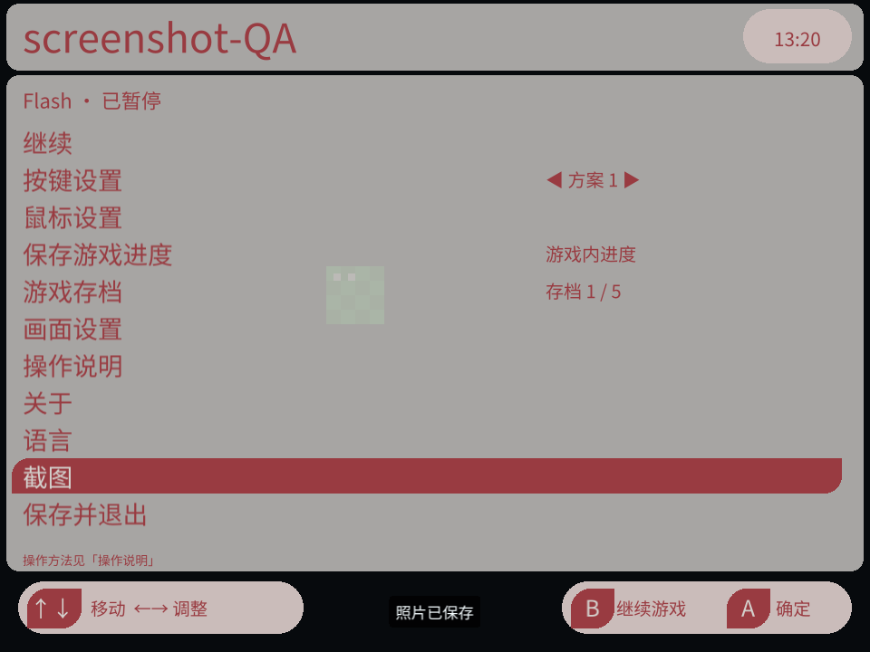

<div align="center">


# Ruffle Flash

**把熟悉的 Flash 小游戏，装进口袋。**

为迷你龙 Miniloong Pocket 1 的 leafOS 打造的 Flash 播放器，基于 Ruffle。

**简体中文** · [English](README.en.md)

[下载安装包](https://github.com/changdy/ruffle-leafos/releases) · [使用指南](ruffle-leafos/README.md) · [反馈问题](https://github.com/changdy/ruffle-leafos/issues)

</div>

| 拳皇 Wing 1.91 | 死神 VS 火影 3.3 |
| --- | --- |
|  |  |

**当前版本：0.8.3 开发预览。** 当前仅支持 **Miniloong Pocket 1 / leafOS**，已在 Leaf 0.13.0 上验证。游戏兼容性和流畅度取决于具体内容，仍在持续完善。

## 为掌机游玩准备的功能

从 Leaf 的 **Flash 分类**选择游戏，使用掌机按键和摇杆游玩；需要调整时，短按机身 **M 菜单键**即可暂停。

| 功能 | 你可以做什么 |
| --- | --- |
| 自定义按键 | 每个游戏保存 **10 套方案**，映射键盘、组合键或鼠标动作，游玩中快捷切换 |
| 按住连发 | 为单个按键设置 **5 / 10 / 15 次每秒**连发，减少重复按键 |
| 鼠标操作 | 摇杆移动、按下点击，支持拖拽、速度调整和光标样式设置 |
| 五份游戏进度 | 为支持原生保存的游戏保留 **5 份独立进度**，也可复制到其他槽位 |
| 截图与封面 | 保存纯游戏画面，或直接把当前画面设为 Leaf 游戏封面 |
| 掌机文字输入 | 点击游戏输入框后，用屏幕键盘输入字母、数字和符号 |
| 画面与语言 | 调整缩放、Flash 画质和 FPS 显示，随时切换简体中文 / English |
| 数据管理 | 从 Apps 管理各游戏的进度与按键配置，清理不再需要的数据 |

## 三步开始

1. **下载。** 打开 [Releases](https://github.com/changdy/ruffle-leafos/releases)，下载 `ruffle-leafos-<版本>.zip` 安装包。
2. **复制。** 解压，将 `Apps/`、`Roms/`、`Images/` 按原层级复制到**系统 SD 卡根目录**，合并同名目录。升级前先正常退出播放器并备份旧安装与用户数据。
3. **开玩。** 返回 Leaf 刷新游戏列表，进入 **Flash** 分类，选择游戏；需要选择模拟器时，选 **Ruffle Flash**。

复制后的目录大致如下，不要在外面再套一层版本号文件夹：

```text
系统 SD 卡/
├─ Apps/mlp1/RuffleProbe.pak/   ← 播放器与“Flash 数据管理”入口
├─ Roms/flash/                 ← Flash 游戏（.swf）
└─ Images/flash/               ← 游戏封面
```

当前打包流程收录《拳皇 Wing 1.91》和《死神 VS 火影 3.3》两款定制版，进入游戏时选择名称含 **`-定制版`** 的主 SWF。死神的 `assets/` 必须与主文件一起保留；资源目录内的 SWF 不是游戏入口。较早的安装包内容可能不同，详见[随包游戏说明](ruffle-leafos/games/README.md)。

你也可以把自己的 `.swf` 放入 `Roms/flash/`；带外部资源的游戏请保留完整目录。[查看添加游戏与封面的方法 →](ruffle-leafos/README.md#添加游戏与封面)

## 先记住这几个操作

**M 是机身菜单键。组合键先按住 M，再按另一个键。**

| 想做什么 | 按法 |
| --- | --- |
| 暂停、设置或退出游戏 | 短按 **M**；菜单中选“保存并退出”返回 Leaf |
| 操作菜单 | 十字键选择，**A** 确认，**B** 返回；暂停主菜单按 B 继续游戏 |
| 使用鼠标（默认方案） | 摇杆移动，摇杆按下为左键点击 |
| 切换按键方案 | **M + A / B**：上一套 / 下一套，自动跳过空方案 |
| 拖拽 | **M + 十字键 ↓**：保持鼠标左键按下，再按一次松开 |
| 调整声音 | 使用机身音量键 |

不同游戏需要的键位不同；启动后没有反应时，先到 **M → 按键设置**核对。[完整操作指南 →](ruffle-leafos/README.md#常用操作)

## 看看实际界面

| 十套按键方案，按游戏分别保存 | 用手柄给角色起名、输入文字 |
| --- | --- |
|  |  |
| **截图：保存照片，也能设置封面** | **Apps：集中管理游戏数据** |
|  |  |
| **暂停后随时调整设置** | **五份独立的游戏原生进度** |
|  |  |

以上均为 Pocket1 实机截图，拍摄于 2026-10-25 至 2026-10-31，包含不同开发预览版本、语言和 Leaf 主题。部分名称以当前指南为准；软键盘截图使用输入测试内容。[截图来源](ruffle-leafos/docs/images/README.md)

## 使用前了解

- **进度取决于游戏自身。** 五个槽位保存游戏的原生数据，不是随时冻结画面的即时存档。请先使用游戏内的保存功能。
- **兼容性仍在完善。** 部分游戏可能出现画面、声音或运行问题；大型游戏可能卡顿。截图不代表全角色、全流程或长时间运行已通过验证。
- **默认使用 OpenGL ES。** Vulkan 可在画面设置中试用，目前属于实验功能，不保证更快。
- **屏幕键盘尚不支持中文拼音组词。** 中英文切换改变播放器界面，不会翻译游戏内容。

## 继续了解

[中文使用指南](ruffle-leafos/README.md) · [English user guide](ruffle-leafos/README.en.md) · [常见问题](ruffle-leafos/README.md#常见问题)

遇到问题欢迎[提交反馈](https://github.com/changdy/ruffle-leafos/issues)，请附游戏名称、播放器与 Leaf 版本、复现步骤；有截图会更容易定位。

开发、构建和验证资料：[工程进度](ruffle-leafos/docs/progress.md) · [工程实现细节](ruffle-leafos/docs/implementation.md) · [文档索引](ruffle-leafos/docs/README.md)

## 致谢与许可

感谢 [Ruffle](https://github.com/ruffle-rs/ruffle)、[aweigit/ruffle-miyooflip](https://github.com/aweigit/ruffle-miyooflip) 以及 Leaf / Jawaka 社区。Ruffle 与公开前端基线使用 MIT / Apache-2.0，本项目新增代码使用 [MIT](ruffle-leafos/adapter/LICENSE)；依赖许可见[第三方声明](ruffle-leafos/docs/THIRD_PARTY.md)。随包游戏及其素材的权利属于原作者或相应权利方，不适用项目代码许可。
