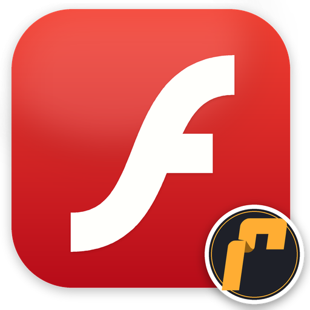
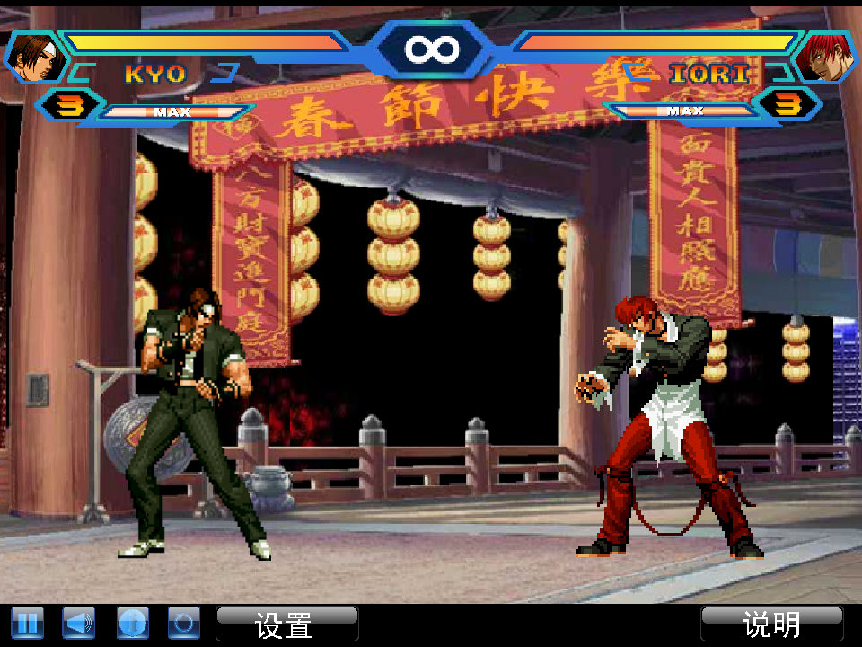
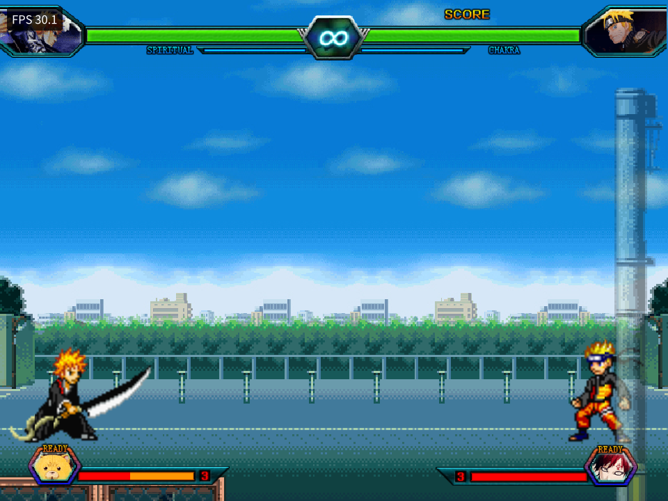

# Ruffle Flash

面向 **Miniloong Pocket 1 / leafOS** 的 Flash 播放器，基于 Ruffle。

另提供 **Pocket AIS（RK3562 / AisOS）** 安装包，从 RGBox「应用 → Ruffle Flash」进入游戏列表。[下载 Pocket AIS 预览版](https://github.com/changdy/ruffle-leafos/releases?q=pocketais) · [AisOS 安装与操作](ruffle-leafos/README.md#aisos-应用菜单)

**简体中文** · [English](README.en.md)

[下载](https://github.com/changdy/ruffle-leafos/releases) · [使用指南](ruffle-leafos/README.md) · [文档索引](ruffle-leafos/docs/README.md) · [问题反馈](https://github.com/changdy/ruffle-leafos/issues)

| 拳皇 Wing 1.91 | 死神 VS 火影 3.3 |
| --- | --- |
|  |  |

当前为开发预览，上图来自 Pocket1。两台掌机的验证场景见[工程进度](ruffle-leafos/docs/progress.md)。

## 快速开始

1. 下载 `ruffle-leafos-<版本>.zip`。[Releases](https://github.com/changdy/ruffle-leafos/releases)
2. 解压，将 `Apps/`、`Roms/`、`Images/` 原样合并到系统 SD 卡根目录。
3. 在 Leaf 刷新游戏列表，从 **Flash** 分类启动游戏。短按机身 **M** 打开暂停菜单。

主包附英文 Bloxorz 与测试探针。拳皇和两款死神定制版位于可选合集。可添加自己的 SWF 或游戏 ZIP。[安装、升级与添加游戏](ruffle-leafos/README.md#安装与升级)

## 掌机功能

- 每款游戏十套按键方案，可映射键盘、组合键和鼠标，支持摇杆光标、拖拽和逐键连发。
- 为支持原生保存的游戏保留五份进度，从 Apps 管理各游戏的进度与按键数据。
- 在暂停菜单保存截图或设置封面，调整画面与界面语言。标准游戏文本框支持屏幕键盘。[掌机操作](ruffle-leafos/README.md#常用操作)

以上为 Pocket1 实机画面。[截图来源](ruffle-leafos/docs/images/README.md)

感谢 Ruffle、aweigit/ruffle-miyooflip 及 Leaf / Jawaka 社区。项目新增代码使用 MIT 许可，游戏与素材的权利属于相应权利方。[项目许可](ruffle-leafos/adapter/LICENSE) · [第三方声明](ruffle-leafos/docs/THIRD_PARTY.md)
