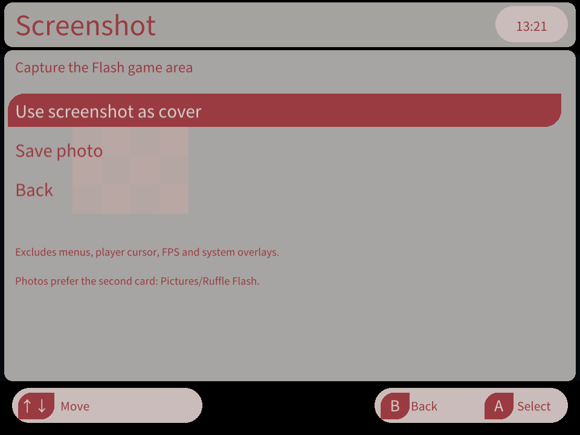
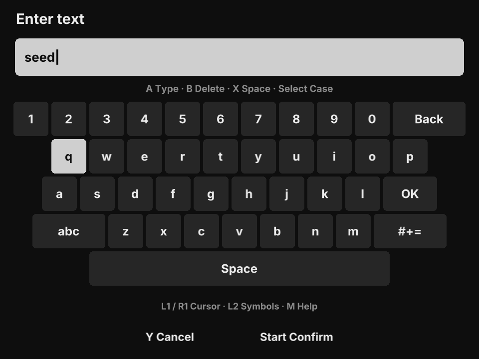
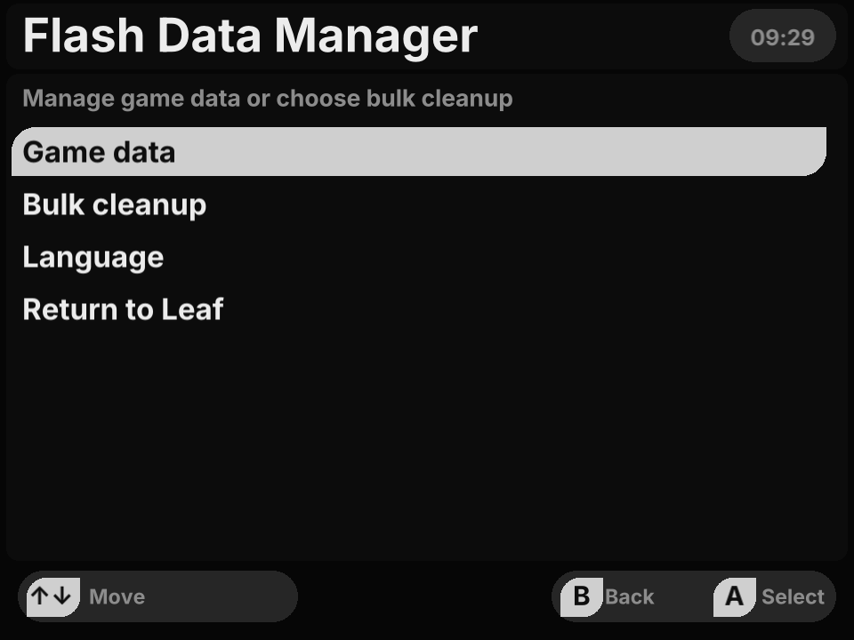

# Ruffle Flash user guide

Play local Flash games with the buttons and stick on your **Miniloong Pocket 1 / leafOS** handheld. This is a development preview, with device checks on **Leaf 0.13.0**.

[简体中文](README.md) · **English** · [Project home](https://github.com/changdy/ruffle-leafos) · [Download](https://github.com/changdy/ruffle-leafos/releases)

[Install](#installing-and-upgrading) · [Add games](#adding-games-and-covers) · [Controls](#everyday-controls) · [Profiles](#control-profiles) · [Progress](#five-progress-slots) · [Screenshots](#screenshots-and-covers) · [FAQ](#frequently-asked-questions)

## Installing and upgrading

1. Download **`ruffle-leafos-<version>.zip`** from [Releases](https://github.com/changdy/ruffle-leafos/releases). This is the installation archive.
2. Before upgrading, choose **Save and exit** from the pause menu. Back up the old `Apps/mlp1/RuffleProbe.pak/` folder and your user data. See [data locations](docs/implementation.md#数据身份与持久化) (Chinese).
3. Extract the archive and copy **`Apps/`, `Roms/` and `Images/`** into the **root of the system SD card**, merging existing folders. Do not place the enclosing version folder inside `Apps/`.
4. Refresh the game list in Leaf and open a game from the **Flash category**. Select **Ruffle Flash** if asked for an emulator.

**The two entry points serve different purposes:** the Flash category launches games; **Flash Data Manager** in Apps manages progress, controls and interface language. Leaf may display the Apps launcher as **Flash 数据管理**. The installation folder keeps its existing `RuffleProbe.pak` name.

The current package includes two custom games. Older archives may have different contents.

| Game | Main file to select inside `Roms/flash/` |
| --- | --- |
| The King of Fighters Wing 1.91 | `拳皇Wing1.91-定制版.swf` |
| Bleach vs Naruto 3.3 | `死神VS火影3.3-定制版/死神VS火影3.3-定制版.swf` |

For Bleach vs Naruto, keep the entire game directory, including the adjacent `assets/` folder. Do not launch resource SWFs. New progress starts with the game’s internal LOW quality setting; change it through **OPTION → QUALITY → APPLY**. [Bundled games and sources](games/README.md) (Chinese)

## Adding games and covers

Put your own `.swf` files in **`Roms/flash/`** and refresh Leaf’s game list. If a game uses external images, sounds or resource SWFs, copy its full directory without changing relative paths. Extract ZIP game archives first.

Put covers in **`Images/flash/`**, using the main SWF’s filename without its extension. Covers go directly in that folder even when the game is in a subfolder. For example:

```text
Roms/flash/My Game/My Game.swf
Roms/flash/My Game/assets/…
Images/flash/My Game.png
```

You can also [make a cover from a screenshot](#screenshots-and-covers) while playing. SWFs with the same filename share a Leaf cover name.

## Everyday controls

**M is the physical menu button. For a shortcut, hold M first, press the other button, then release.**

| Action | Controls |
| --- | --- |
| Pause | Tap M; press B in the main pause menu to resume |
| Return to Leaf | M → Save and exit; saves only native progress the game has already produced |
| Navigate menus | D-pad Up / Down to select, A to open or confirm, B to go back; Left / Right adjusts editable settings |
| Switch profiles | M + A for previous, M + B for next; empty profiles are skipped |
| Swap directional controls | M + X swaps D-pad and stick directions; repeat or exit to restore; saved profiles are unchanged |
| Hold the left mouse button / drag | M + D-pad Down toggles the hold; pausing or changing profiles also releases it |
| Adjust volume | Physical volume buttons; M + volume adjusts Leaf brightness |
| Open built-in help | M → Controls guide; Left / Right or L1/R1 switches help groups |

Shortcuts do not also open the pause menu, and holding them does not repeatedly switch profiles. Release the buttons and center the stick before resuming play.

## Control profiles

Each game has **10 independent profiles**. Assign keyboard keys, combinations of up to four keys, mouse movement, clicks and wheel actions to physical buttons and stick directions or presses.

1. Open **M → Controls**. With Controls selected in the main menu, Left / Right switches profiles; A opens the editor.
2. Select a physical button or stick action with the D-pad, then press A to choose its action. L1/R1 switches action categories.
3. In the editor, L1/R1 switches profiles. Choose **Save** at the bottom to apply changes. Leaving an edited profile prompts you to save or discard changes, or keep editing.

**Turbo:** select a button in the editor and press **Y** to cycle through Off / 5 / 10 / 15 presses per second, then save. Keyboard keys, key combinations and left/right mouse clicks support turbo while held. Releasing stops it. Actual frequency may drop when a game stalls.

Profiles 1 and 2 provide default bindings; profiles 3–10 start empty. You can edit empty profiles in the menu. Once assigned an action and saved, they become available through M+A/B.

<details>
<summary>Default bindings</summary>

| Handheld input | Profile 1 | Profile 2 |
| --- | --- | --- |
| D-pad Up / Down / Left / Right | W / S / A / D | ↑ / ↓ / ← / → |
| A / B / X / Y | J / K / L / I | 1 / 2 / 3 / 4 |
| L1 / R1 | Space / Enter | Space / Enter |
| Select / Start | Tab / Esc | Tab / Esc |
| Stick movement / press | Mouse movement / left click | Mouse movement / left click |
| L2 / R2 | Unbound | Unbound |

These are starting points. Adjust them to match each game’s own instructions.

</details>

## Mouse and cursor

Default profiles move the mouse with the stick and left-click with a stick press. To drag, toggle the left-button hold with **M + D-pad Down**, then move the stick.

Open **M → Mouse settings** to adjust mouse speed for the current session. Choose from four cursor styles, seven colors and four sizes; **Save appearance (global)** applies the look across all games. The cursor hides after 3.5 seconds without movement; moving shows it again.

| Control editor | Mouse appearance and speed |
| --- | --- |
|  |  |

## Five progress slots

**Save inside the game first; the player keeps that data.** The five slots store the game’s native progress (Flash SharedObject), rather than the full running state. If a game has no native save system, the player cannot create resumable progress for it. Control profiles and progress slots are independent.

| Action | Steps |
| --- | --- |
| Save current progress | Use the game’s save function, then M → Save game progress |
| Use another slot | M → Game saves, select a slot and press A; confirm to restart with that slot. An empty slot starts fresh |
| Copy current progress | Select another slot in the list, press Y and confirm |
| Save to the current slot | Select the current slot and press Y; A on the current slot returns without restarting |
| Continue next time | Games with existing progress show the five-slot picker before starting |

The player also attempts to commit progress when opening menus, exiting normally and responding to game save requests. Slot timestamps show the last data change in Beijing time (UTC+8).

Progress is identified by **SWF content**: renaming or moving the same file preserves its identity; a different game build gets separate progress. Controls use the **ROM path**, so they do not automatically follow a renamed or moved file. Back up before replacing games. Automatic migration of old `.sol` files, progress import/export and instant save states are not available yet.

## Screenshots and covers

When you reach a frame you want to keep, tap **M → Screenshot**, then choose:

| Option | Destination |
| --- | --- |
| **Use screenshot as cover** | `Images/flash/<main SWF filename>.png` on the game’s card. Replacing an existing cover requires confirmation; refresh the Leaf game list afterward |
| **Save photo** | `Pictures/Ruffle Flash/`, named with the game and device-local date/time. Prefers an independently mounted secondary TF card; otherwise uses the system card |

Screenshots capture the visible game area, trimming borders outside the stage and excluding player menus, cursor and FPS. Text and cursors drawn by the game itself remain. Images use the current screen rendering size, rather than a fresh render at the SWF’s original resolution. You remain in the pause menu after capture.

If available memory is too low or cannot be checked, capture reports a failure and stays paused. You can retry later; an existing cover is preserved when capture is refused.

| Five progress slots | Screenshots and covers |
| --- | --- |
|  |  |

## Display and sound

Open **M → Display settings**. Left / Right or A changes settings, which save automatically and apply to all games:

- **Scaling:** keep aspect ratio, stretch to fill, or original size. Original-size content larger than the screen is cropped.
- **Flash quality:** Low / Medium / High. Adjust this separately from a game’s internal quality setting.
- **FPS counter:** toggle the Flash frame-rate display at the top left. It is not the screen refresh rate and does not fully describe smoothness during stalls.
- **Graphics API:** OpenGL ES by default, with experimental Vulkan available. Switching requires confirmation and restarts the game, restoring only saved native progress. Switch back to OpenGL ES if you encounter rendering or stability problems. Vulkan may not be faster.

Use the physical volume buttons for sound. A system volume indicator appears at the top right.


## Interface language

Choose **Simplified Chinese / English**. First use follows the Leaf system language; after that, the player keeps your saved preference.

Open **M → Language**, or Language on the Apps manager home screen, select a language and press A. The choice applies immediately and saves for all games. It does not translate game content or user-created names.

## Text input

Click a standard editable game text field with the mouse to open the on-screen keyboard. The game pauses while you type. **Start confirms; Y cancels**, discarding the draft.

<details>
<summary>On-screen keyboard controls</summary>

| Action | Controls |
| --- | --- |
| Select / type a character | D-pad / A |
| Backspace / space | B / X |
| Letter case / symbols | Select / L2, or choose the on-screen `#+=` key |
| Move the text cursor | L1 / R1 |
| New line in a multiline field | R2 |
| Confirm / cancel | Start or the on-screen Confirm key / Y |
| Toggle help | Tap M |

</details>

The keyboard provides letters, numbers and symbols and can edit existing Unicode text. **Chinese Pinyin composition is not available yet.** Games with custom-drawn input interfaces may not open it automatically. Read-only text does not open the keyboard.

| On-screen keyboard | Flash Data Manager |
| --- | --- |
|  |  |

## Apps data manager

Open **Apps → Flash 数据管理 (Flash Data Manager) → Game data**. Use Up / Down to select a game, L1/R1 to change pages, A to open its details and B to go back. Clear all saves or reset controls for that game. Use **Bulk cleanup** on the home screen for all-game operations.

The list includes games with stored progress or control configuration. Missing game files may be marked **Unavailable**, but their data remains manageable. A game you merely launched without saving data may not appear.

Cleanup requires confirmation and defaults to Cancel. Confirmed data moves to a local archive; game files, covers and global display settings stay in place. The archive has no one-click restore interface, so back up before cleanup. [Configuration, progress and archive locations](docs/implementation.md#数据身份与持久化) (Chinese)

## Frequently asked questions

**No Flash category or games after installation?** Refresh Leaf’s game list. Check that the package is at `Apps/mlp1/RuffleProbe.pak/` and SWFs are in `Roms/flash/`, without an extra enclosing folder. Leaf 0.13.0 is the verified system version. The Apps manager does not launch games.

**The game ignores my buttons.** Each game uses different keys. Adjust M → Controls, or try clicking its Start button with the mouse. Default profiles move the mouse with the stick and click with a stick press.

**Why do profile shortcuts skip some profiles?** M+A/B cycles only through profiles with assigned actions. Open an empty profile from the pause menu, assign an action and save it.

**Why does loading progress not return to the exact frame I saved?** Slots store native game data. Continue through the game’s own load or continue screen. Games without native saving do not currently support instant save states.

**Slow play, missing resources or rendering problems?** Check that external resource folders are complete. Try reducing the game’s internal quality or Flash quality. If using Vulkan, try OpenGL ES. Not all SWFs are guaranteed to work, and long-session stability is still being improved.

**The cover did not update, or I cannot find a photo.** Refresh Leaf’s game list after saving a cover. Photos are in `Pictures/Ruffle Flash/`; check the secondary card first if independently mounted. For write errors, check free space and whether the card is writable.

**How do I report a problem?** Open an [issue](https://github.com/changdy/ruffle-leafos/issues) with the game name, source or version, Ruffle Flash and Leaf versions, steps to reproduce, and screenshots or error messages.

---

Screenshots are Pocket1 captures from October 25–31, 2026, across different development previews and themes. Follow this guide where older labels differ. Keyboard captures use test input content. [Screenshot sources](docs/images/README.md)

Developer resources (Chinese): [Progress and validation](docs/progress.md) · [Implementation and builds](docs/implementation.md) · [Documentation index](docs/README.md). Licenses: [Project MIT](adapter/LICENSE) · [Third-party notices](docs/THIRD_PARTY.md) · [Game rights](games/README.md).
