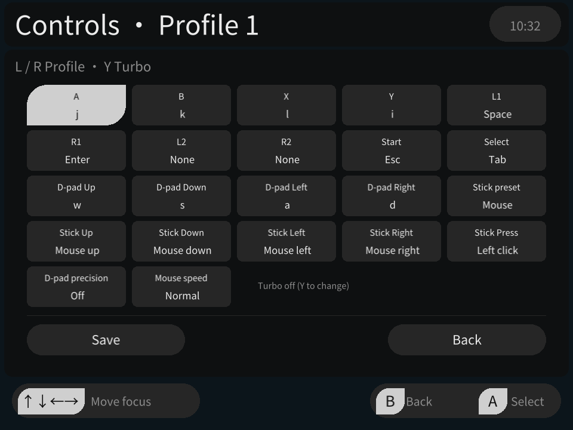
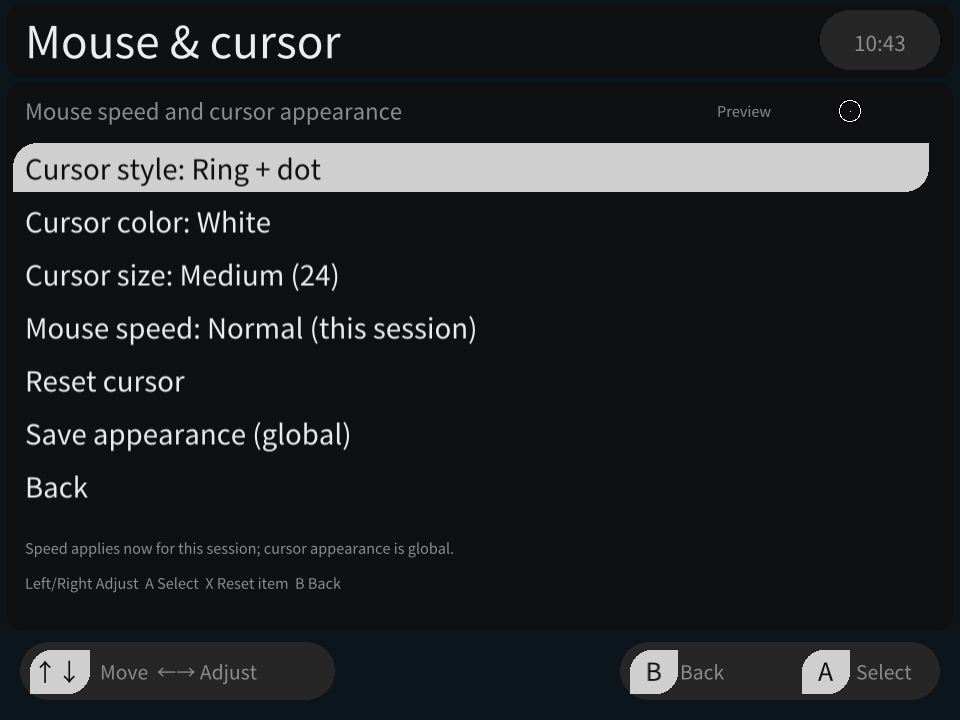
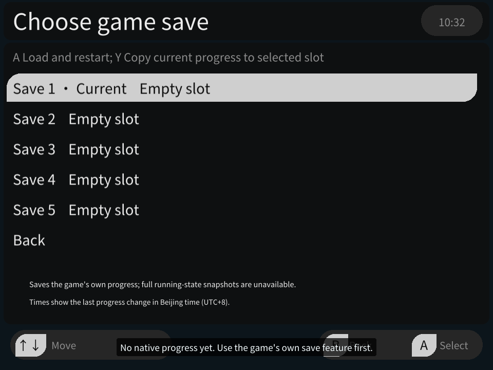
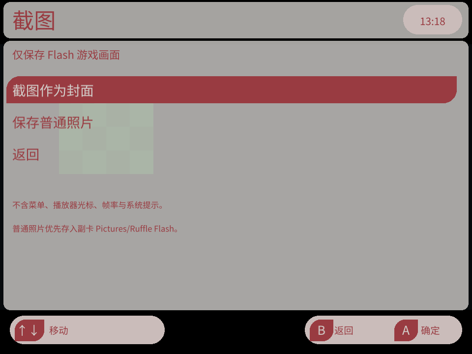
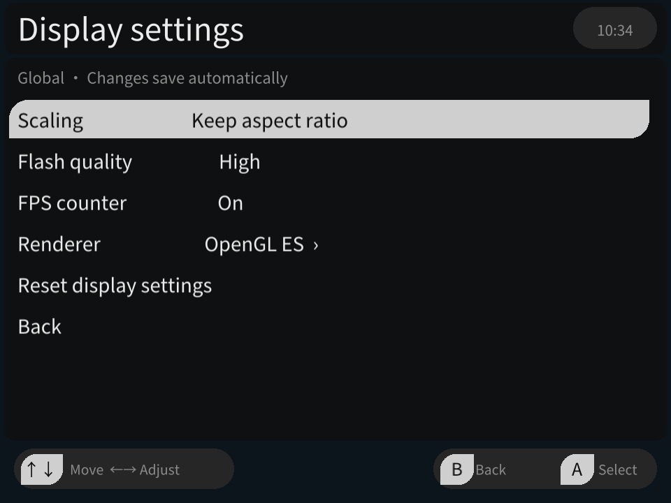
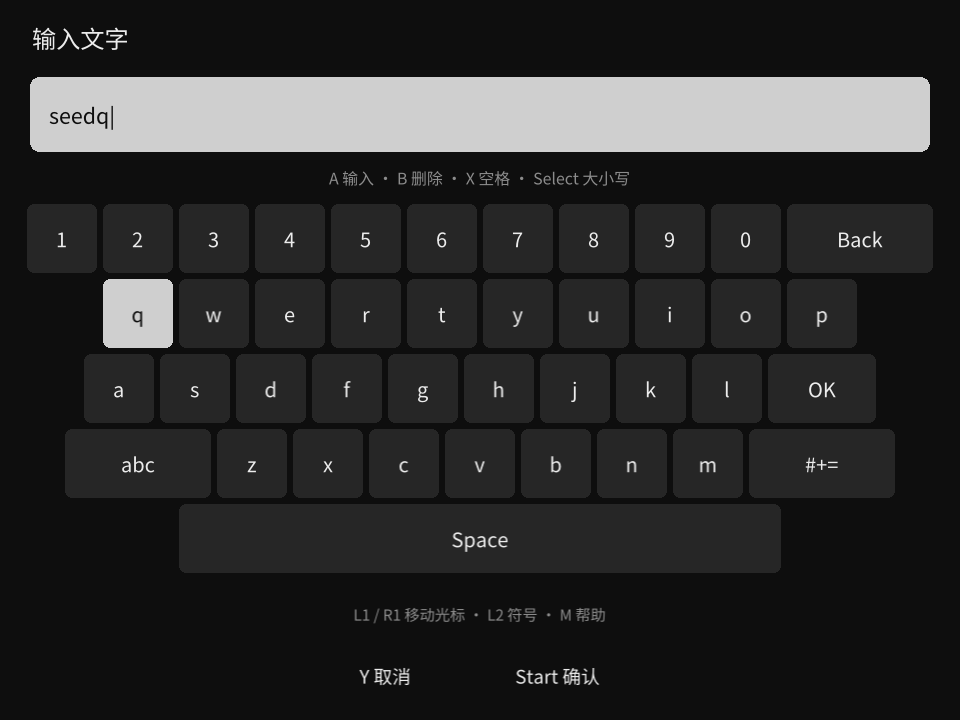
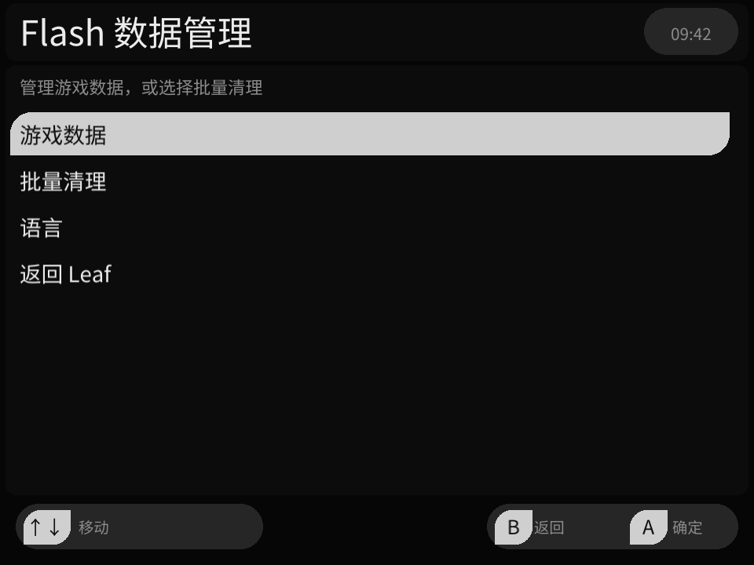

# Ruffle Flash 使用指南

在迷你龙 **Miniloong Pocket 1 / leafOS** 上，用掌机按键和摇杆游玩本地 Flash 游戏。当前为开发预览，已验证系统为 **Leaf 0.13.0**。

**简体中文** · [English](README.en.md) · [项目首页](https://github.com/changdy/ruffle-leafos) · [下载安装包](https://github.com/changdy/ruffle-leafos/releases)

[安装](#安装与升级) · [添加游戏](#添加游戏与封面) · [常用操作](#常用操作) · [按键](#按键映射) · [进度](#五份游戏进度) · [截图](#截图与封面) · [常见问题](#常见问题)

## 安装与升级

1. 从 [Releases](https://github.com/changdy/ruffle-leafos/releases) 下载 **`ruffle-leafos-<版本>.zip`**，这是可直接安装的包。
2. 升级时，先从暂停菜单选择“保存并退出”，备份旧的 `Apps/mlp1/RuffleProbe.pak/` 和用户数据。备份位置见[数据路径](docs/implementation.md#数据身份与持久化)。
3. 解压，把包内 **`Apps/`、`Roms/`、`Images/`** 按原层级复制到**系统 SD 卡根目录**，合并同名目录。不要把整个版本文件夹放到 `Apps/` 内。
4. 返回 Leaf，刷新游戏列表，从 **Flash 分类**打开游戏；模拟器选择 **Ruffle Flash**。

**两个入口各有用途：** Flash 分类用来启动游戏；Apps 中的 **Flash 数据管理**用来管理进度、按键和界面语言。安装目录沿用 `RuffleProbe.pak`，显示名称是 Ruffle Flash。

当前打包收录两款定制游戏，启动文件如下。较早的安装包内容可能不同。

| 游戏 | `Roms/flash/` 内选择的主文件 |
| --- | --- |
| 拳皇 Wing 1.91 | `拳皇Wing1.91-定制版.swf` |
| 死神 VS 火影 3.3 | `死神VS火影3.3-定制版/死神VS火影3.3-定制版.swf` |

死神须保留整个游戏目录及相邻 `assets/`，不要启动资源 SWF。新进度默认使用游戏内部 LOW 画质，可到游戏的 **OPTION → QUALITY → APPLY** 调整。[随包游戏与来源说明](games/README.md)

## 添加游戏与封面

把自己的 `.swf` 放进 **`Roms/flash/`**，然后刷新 Leaf 游戏列表。有外部图片、声音或资源 SWF 的游戏，请复制完整目录，保持资源相对位置。ZIP 游戏包需要先解压。

封面放进 **`Images/flash/`**，名称与游戏主 SWF 去掉扩展名后的名称相同。即使游戏位于子目录，封面也直接放在 `Images/flash/` 下。例如：

```text
Roms/flash/我的游戏/我的游戏.swf
Roms/flash/我的游戏/assets/…
Images/flash/我的游戏.png
```

也可以在游戏中直接[截图设为封面](#截图与封面)。同名 SWF 会共用同一个 Leaf 封面名称。

## 常用操作

**M 是机身菜单键。组合键请先按住 M，再按另一个键，最后松开。**

| 场景 | 操作 |
| --- | --- |
| 暂停游戏 | 短按 M 打开暂停菜单；暂停主菜单按 B 继续 |
| 返回 Leaf | M → 保存并退出；仅保存游戏已经产生的原生进度 |
| 操作菜单 | 十字键 ↑ ↓ 选择，A 进入或确认，B 返回；可调项目用 ← → 调整 |
| 切换按键方案 | M + A 上一套，M + B 下一套；循环时跳过空方案 |
| 交换方向操作 | M + X 互换十字键与摇杆四方向，再按一次恢复；退出后恢复，不改变已保存方案 |
| 鼠标左键保持 / 拖拽 | M + 十字键 ↓ 开启，再按一次松开；暂停或换方案也会松开 |
| 调整音量 | 机身音量键；M + 音量键调节 Leaf 亮度 |
| 查看内置帮助 | M → 操作说明，用 ← → 或 L1/R1 切换说明分组 |

组合键不会同时打开暂停菜单，按住也不会连续切换。恢复游戏前请松开按键并让摇杆归中。

## 按键映射

每个游戏有 **10 套独立方案**，支持键盘、最多四键的组合键、鼠标移动 / 点击 / 滚轮，以及摇杆方向和按下动作。

1. 按 **M → 按键设置**。主菜单选中该项后，← → 可直接切换方案，A 进入编辑。
2. 用十字键选择要改的实体键或摇杆动作，按 A 选择新动作；动作页用 L1/R1 切换类别。
3. 编辑页用 L1/R1 切换方案，底部选择 **保存**应用修改。离开未保存的方案时会询问如何处理。

**连发：** 在编辑页选中按键后，按 **Y** 循环关闭 / 5 / 10 / 15 次每秒，再保存。键盘、组合键和鼠标左右键支持按住连发；松开即停。游戏卡顿时实际频率可能降低。

方案 1、2 提供默认键位；方案 3—10 初始为空。空方案仍可在菜单中编辑，绑定并保存后就会加入 M+A/B 的快捷切换。

<details>
<summary>查看默认键位</summary>

| 掌机输入 | 方案 1 | 方案 2 |
| --- | --- | --- |
| 十字上 / 下 / 左 / 右 | W / S / A / D | ↑ / ↓ / ← / → |
| A / B / X / Y | J / K / L / I | 1 / 2 / 3 / 4 |
| L1 / R1 | Space / Enter | Space / Enter |
| Select / Start | Tab / Esc | Tab / Esc |
| 摇杆移动 / 按下 | 鼠标移动 / 左键 | 鼠标移动 / 左键 |
| L2 / R2 | 未绑定 | 未绑定 |

以上是通用起点，不保证符合每款游戏；请根据游戏内的操作说明调整。

</details>

## 鼠标与光标

默认方案用摇杆移动鼠标、摇杆按下左键点击。需要拖拽时，用 **M + 十字键 ↓** 保持左键，再移动摇杆。

进入 **M → 鼠标设置**，可调整本次运行的鼠标速度。光标有四种样式、七种颜色和四档大小；选择 **保存外观（全局）** 后，所有游戏共用。光标静止 3.5 秒后自动隐藏，移动即可显示。

| 按键编辑（英文界面示例） | 鼠标外观与速度（英文界面示例） |
| --- | --- |
|  |  |

## 五份游戏进度

**先在游戏里保存，再由播放器保管。** 五个槽位存的是游戏自身的原生进度（Flash SharedObject），不保存完整运行画面。游戏没有原生保存功能时，播放器也无法创建可继续的游戏进度。按键方案和进度槽位互相独立。

| 想做什么 | 操作 |
| --- | --- |
| 保存当前进度 | 使用游戏内保存后，M → 保存游戏进度 |
| 选择另一份进度 | M → 游戏存档，选槽位按 A，确认后重启游戏并载入；空槽从新进度开始 |
| 复制当前进度 | 在存档列表选中其他槽位，按 Y，再确认复制 |
| 保存到当前槽 | 列表选中当前槽后按 Y；选中当前槽按 A 返回，不重启 |
| 下次继续 | 已有进度时，重开游戏会先显示五槽选择页 |

播放器也会在打开菜单、正常退出和游戏请求保存时尝试提交进度。槽位时间显示最后一次数据变化的北京时间。

进度按 **SWF 内容**识别：改名、移动仍可匹配，换成内容不同的版本则会分开。按键按 **ROM 路径**识别，改名或移动后不会自动跟随。更换游戏版本前请备份；旧 `.sol` 自动迁移、进度导入导出和即时存档尚未提供。

## 截图与封面

在想保留的画面短按 **M → 截图**，选择：

| 选项 | 保存到哪里 |
| --- | --- |
| **截图作为封面** | 游戏所在卡的 `Images/flash/<游戏主文件名>.png`；已有封面时询问是否覆盖，返回 Leaf 后刷新游戏列表 |
| **保存普通照片** | `Pictures/Ruffle Flash/<游戏名>-YYYYMMDD-HHMMSS.png`，使用设备本地日期时间，不附加序号；优先使用已挂载的独立副 TF 卡，没有时使用系统卡 |

截图只保留当前可见的游戏区域，去掉舞台外黑边，不含播放器菜单、光标和 FPS。游戏自己绘制的文字或光标会保留。图片采用当前屏幕渲染尺寸，不会按 SWF 原始分辨率重新生成；截图后仍停留在暂停菜单。

内存余量不足或无法检查时，会提示截图失败并保持暂停；可稍后重试，已有封面不会因这次拒绝而改变。

同名照片已存在时会提示保存失败，请隔一秒重试，不会覆盖已有照片。

| 五份游戏进度（英文界面示例） | 截图与封面 |
| --- | --- |
|  |  |

## 画面与声音

进入 **M → 画面设置**，用 ← → 或 A 调整，自动保存并用于所有游戏：

- **缩放：** 保持比例、铺满屏幕或原始大小。原始大小超出屏幕时会裁切。
- **Flash 画质：** 低 / 中 / 高；这是播放器设置，与游戏内部画质分别调整。
- **FPS：** 开关左上角的 Flash 帧率显示。它不是屏幕刷新率，卡顿时也不能单独代表流畅度。
- **渲染接口：** 默认 OpenGL ES，可试用实验性 Vulkan。切换需要确认并重启游戏，只恢复已保存的原生进度。遇到画面或稳定性问题可切回 OpenGL ES；Vulkan 不保证更快。

声音使用机身音量键调节，右上角会显示系统音量。



## 界面语言

支持 **简体中文 / English**。首次使用会根据 Leaf 系统语言选择；之后以播放器里保存的选择为准。

游戏中 **M → 语言（Language）**，或在 Apps 数据管理首页选择同名项目，选语言并按 A 即时切换、自动保存。语言设置由所有游戏共用，不翻译游戏内容或用户命名。

## 文字输入

用游戏鼠标点击标准可编辑输入框，会自动弹出屏幕键盘。输入期间暂停游戏；**Start 确认，Y 取消**，取消会丢弃本次草稿。

<details>
<summary>查看屏幕键盘操作</summary>

| 操作 | 按法 |
| --- | --- |
| 选择 / 输入字符 | 十字键 / A |
| 退格 / 空格 | B / X |
| 大小写 / 符号 | Select / L2（也可选择屏幕上的 `#+=`） |
| 移动文字光标 | L1 / R1 |
| 多行输入框换行 | R2 |
| 确认 / 取消 | Start 或屏幕“确认” / Y |
| 打开 / 关闭帮助 | 短按 M |

</details>

屏幕键盘提供字母、数字和符号，可编辑已有 Unicode 文字，**尚无中文拼音组词输入**。游戏自绘的输入界面可能无法自动弹出键盘；只读文本不会弹出。

| 屏幕键盘 | Flash 数据管理 |
| --- | --- |
|  |  |

## Apps 数据管理

从 **Apps → Flash 数据管理 → 游戏数据**进入游戏列表，↑ ↓ 选择，L1/R1 翻页，A 进入游戏详情，B 返回。可清空该游戏的全部存档或重置按键；所有游戏一起清理时使用首页的 **批量清理**。

这里只列出实际留有进度或按键配置的游戏。游戏文件找不到时，可能标记为“已失效 / Unavailable”，其数据仍可管理；刚启动过但没有保存数据的游戏可能不在列表中。

清理前会二次确认，默认取消。确认后，数据移入本地归档；游戏文件、封面和全局画面设置保留。归档不等于已提供一键恢复功能；清理前仍建议备份。[配置、进度和归档路径](docs/implementation.md#数据身份与持久化)

## 常见问题

**安装后看不到 Flash 分类或游戏？** 先刷新 Leaf 游戏列表，检查安装路径是 `Apps/mlp1/RuffleProbe.pak/`，SWF 位于 `Roms/flash/`。确认没有额外的外层文件夹。当前已验证系统为 Leaf 0.13.0；Apps 数据管理本身不用于启动游戏。

**游戏不响应按键？** 不同游戏用的键不同，到 M → 按键设置调整；有些开始按钮需要鼠标点击。默认方案可用摇杆移动、按下点击。

**为什么快捷切换跳过某些方案？** M+A/B 只切换已绑定动作的方案。空方案可从暂停菜单进入编辑，保存后就能参与快捷切换。

**点了保存，为什么不能回到刚才的画面？** 保存的是游戏原生数据，载入后从游戏自身的继续入口恢复。没有原生保存功能的游戏暂不支持即时存档。

**游戏卡顿、缺资源或显示异常？** 先确认外部资源目录完整，尝试降低游戏内部画质或 Flash 画质；使用 Vulkan 时可切回 OpenGL ES。当前不保证所有 SWF 正常运行，长时稳定性仍在完善。

**封面没有更新，或找不到照片？** 封面保存后要刷新 Leaf 游戏列表；普通照片在 `Pictures/Ruffle Flash/`，有独立已挂载副卡时优先查看副卡。写入报错时检查卡的空间与读写状态。

**如何反馈？** 到 [Issues](https://github.com/changdy/ruffle-leafos/issues) 附上游戏名称、来源或版本、Ruffle Flash 与 Leaf 版本、操作步骤、截图或错误信息。

---

截图来自 2026-10-25 至 2026-10-31 的 Pocket1 实机记录，包含不同开发预览与主题，部分旧名称以本指南为准；软键盘使用测试输入内容。[截图来源](docs/images/README.md)

开发者资料：[工程进度与验证范围](docs/progress.md) · [实现与构建](docs/implementation.md) · [文档索引](docs/README.md)。许可：[项目 MIT](adapter/LICENSE) · [第三方声明](docs/THIRD_PARTY.md) · [游戏权利说明](games/README.md)。
