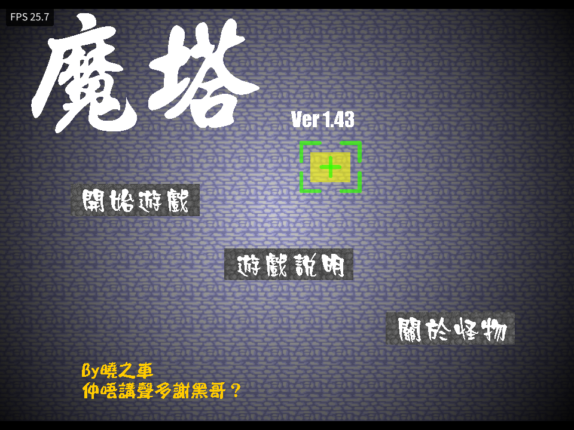
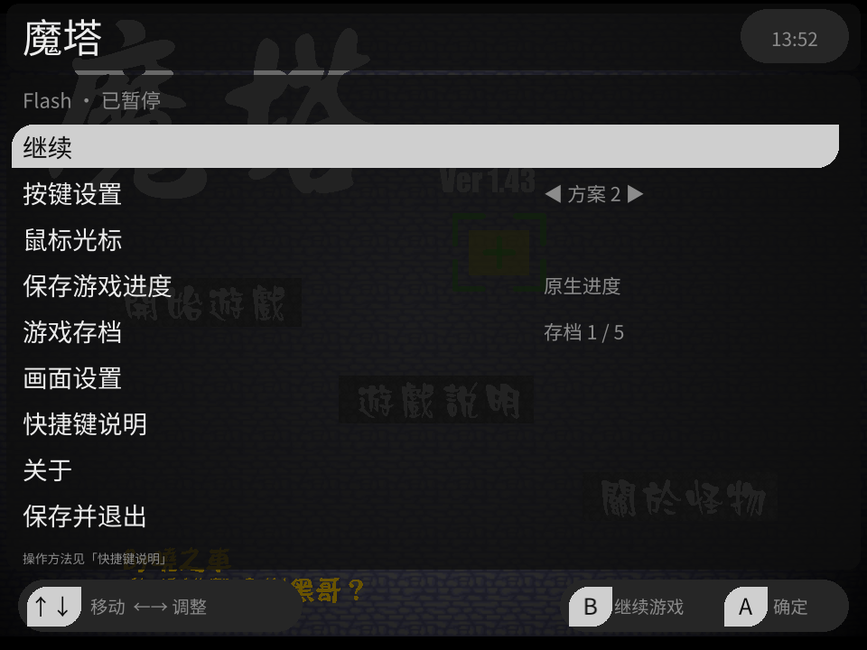
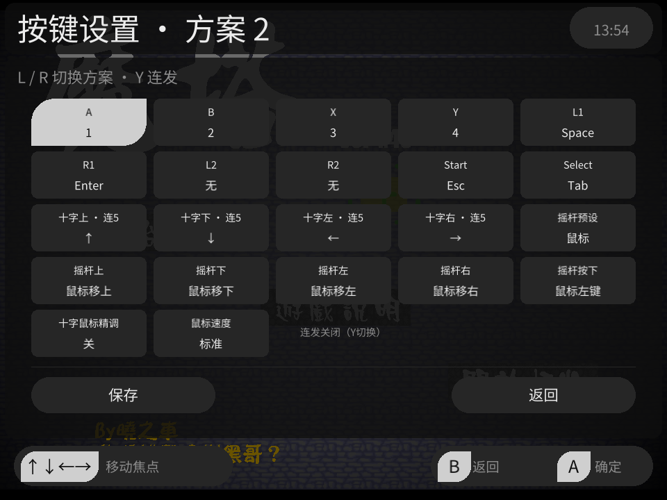
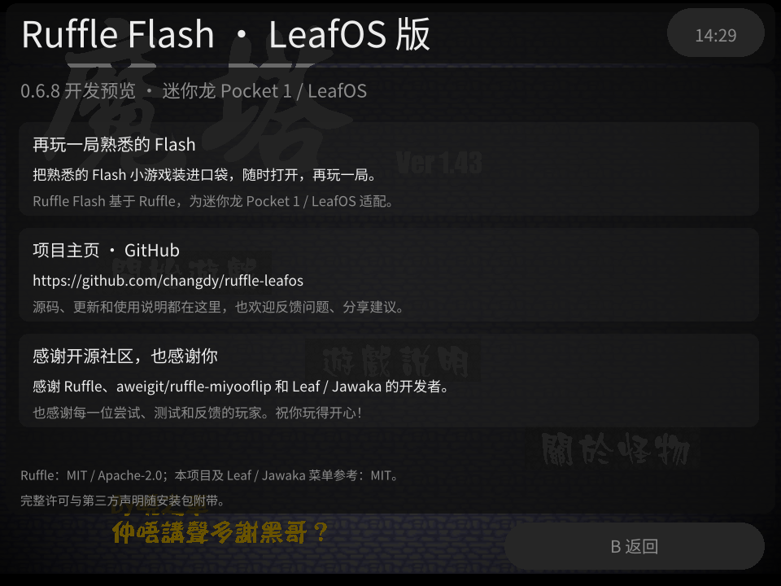

# Ruffle Flash

面向迷你龙 Miniloong Pocket 1 / LeafOS 的本地 Flash 播放器，基于 Ruffle 和固定的 aweigit/ruffle-miyooflip 公开源码。当前版本为 **0.7.1 开发预览**，支持中英文界面，默认 OpenGL ES，可选实验性 Vulkan 绘制。已验证设备为 Leaf 0.13.0 / ARM64 / Mali-G52 / GLES 3.2 / Vulkan 1.2.218。文档整理于 2026-10-28，验证范围见[工程进度](docs/progress.md)。

从 Leaf 的 Flash 分类选择 SWF 即可游玩；支持每游戏十个按键方案、逐键连发、五份游戏原生进度、全局画面设置和全局鼠标光标。Apps 入口用于数据管理。五份进度保存游戏的 SharedObject 数据，完整运行现场快照尚未实现；广泛游戏体验、断电与休眠等验收仍待完成。

GitHub 仓库：[changdy/ruffle-leafos](https://github.com/changdy/ruffle-leafos)。掌机应用名为 **Ruffle Flash**，Apps 入口显示为 **Flash 数据管理**。

## 实机截图

以下截图于 2026-10-25 通过 ADB 从迷你龙 Pocket 1 / LeafOS 实机抓取，展示 **0.6.8 开发预览**的实际游戏与菜单界面；关于页截图已同步本次文案更新。游戏画面来自用户安装的 SWF，不随项目分发。

| 游戏运行 | 暂停菜单 |
| --- | --- |
|  |  |
| 按键设置 | 关于 |
|  |  |

| 文档 | 负责内容 |
| --- | --- |
| 本 README | 项目介绍、安装与完整使用方法 |
| [工程进度](docs/progress.md) | 已完成、待办、验收边界、版本和验证证据 |
| [工程实现细节](docs/implementation.md) | 模块、实现约定、数据格式、来源、构建与发布 |

格式契约和历史资料见[文档索引](docs/README.md)。README 使用的实机截图随仓库保存在 `docs/images/`；本地发布包和完整验证截图保存在工作区 `outputs/`，不随 Git 克隆。自行构建见[工程实现细节](docs/implementation.md#构建环境与命令)。

## 安装与入口

自动发布的安装包从 [GitHub Releases](https://github.com/changdy/ruffle-leafos/releases) 下载 **`ruffle-leafos-<版本>.zip`**。Release 说明附构建提交、上一版本以来的 commit 信息和 ZIP 的 SHA-256。当前发布为开发预览；自动编译与主机测试通过不代表已完成实机验收。

正常退出播放器、备份现有 `RuffleProbe.pak` 和用户数据后，将安装 ZIP 解压，把其中的 **`Apps/`、`Roms/`、`Images/` 按原层级复制到迷你龙系统 SD 卡根目录并合并目录**，即可安装或覆盖升级；也可直接解压到该根目录。ZIP 没有额外的版本号外层文件夹，安装目标为 `Apps/mlp1/RuffleProbe.pak/`。该目录沿用旧包标识，以便直接覆盖升级；显示名称与数据位置分开维护。

0.6.9 收录新版关于介绍、GitHub 项目地址与社区致谢，已通过自动构建并发布 [v0.6.9 安装包](https://github.com/changdy/ruffle-leafos/releases/tag/v0.6.9)，线上 ZIP 的版本、校验值和内容核对通过。相同页面代码此前已通过 84 项主机回归、ARM64 release 构建及 Pocket 1 实机排版与 A/B 返回核对；上方截图来自更新文案后的 0.6.8 构建。0.6.9 安装包的独立实机安装尚未验证，各批次范围见[工程进度](docs/progress.md)。

SWF 放入 `Roms/flash/`，封面放入 `Images/flash/`；有外部资源的游戏保留相对目录结构。从 Leaf 的 Flash 分类打开游戏，模拟器列表显示为 Ruffle Flash；Apps 中的“Flash 数据管理”用于管理配置与游戏进度。Apps 入口与 Flash 游戏分类统一使用项目自定义的红色 Flash / Ruffle 图标；各游戏封面仍由 `Images/flash/` 提供。

2026-10-26 已在 Pocket1 对《死神 VS 火影 2.6》和《拳皇 Wing 1.91》进行实机排查。前者需要主 SWF 旁的 `fighter/`、`fighter/fz/` 角色及援助文件，仅下载主 SWF 会卡在对战加载；后者在原 0.7.0 播放器上因内存不足被系统结束。当前源码按首次显示创建静态图形，并在完整游戏帧后回收未使用的静态 GPU 资源；优化版已在 GLES 运行死神、在 Vulkan 运行拳皇的实际对战。**拳皇的 GLES 多局测试仍触发过 OOM**；该轮安装使用当时的每游戏配置，仅为新下载的拳皇保存 Vulkan 偏好；当前源码已改用下文所述的全局画面配置。全部角色和长时稳定性尚未验收，不能视为完整兼容性保证。详见[本轮验证记录](docs/validation/fighting-games-20261026.json)。游戏文件不随应用分发。

《死神 VS 火影 3.3》的部分 4399 单文件包会显示 `WARNING / No running in a loader.`，内嵌中文实际为“不允许加壳运行”。本次本地适配副本改为直接启动原游戏、从旁边的 `assets/` 读取完整资源，已通过 Pocket1 / GLES 的标题、选人、一护对鸣人实战、暂停恢复与正常退出检查。使用时把 **`死神VS火影3.3-离线版/` 整个目录**放到 `Roms/flash/`，刷新 Leaf 游戏列表后打开目录内同名 SWF；不能只复制主文件。该副本使用独立进度身份，原文件保留，游戏不随应用分发。仍有脚本与音频解码告警，全部角色、变身、多局和长时稳定性尚未验收；详见[3.3 排查与适配记录](docs/validation/bvn33-offline-20261026.md)。

本地另有独立的《死神 VS 火影 3.3》脚本优化实验副本，已在掌机保留为 `Roms/flash/死神VS火影3.3-脚本优化版/`。刷新游戏列表后选择目录内同名 SWF，保留相邻 `assets/`；原离线版保留，副本使用独立原生进度，不随应用分发。已完成限定角色/场景的隔离实测，全部角色、长时及新目录的正式 Flash 索引启动仍未验收，仍有偶发长帧和脚本告警；范围见[实机对照记录](docs/validation/bvn33-swf-device-20261027.md)。

## 菜单与快捷键

M 是机身菜单键。组合键的按法是：**先按住 M，再按另一个键，最后松开**。游戏中的组合键如下；菜单里的操作另见下表。

| 操作 | 作用 |
| --- | --- |
| 短按 M（Menu） | 打开暂停菜单 |
| 按住 M，再按 A | 切到上一套非空按键方案，循环并提示名称，跳过全空方案 |
| 按住 M，再按 B | 切到下一套非空按键方案，循环并提示名称，跳过全空方案 |
| 按住 M，再按 X | 交换十字键和摇杆四方向的操作；再按一次或退出游戏后恢复，摇杆按下不变 |
| 按住 M，再按十字键 ↓ | 保持鼠标左键按下，便于拖拽；再按一次松开。暂停、换方案、失焦、断连或退出也会松开 |

| 菜单操作 | 按法 |
| --- | --- |
| 选择菜单项 | 十字键 ↑ ↓；按 A 进入或确认，按 B 返回；暂停主菜单按 B 继续游戏 |
| 调整当前项目 | 十字键 ← →；适用于画面、鼠标等可调项目 |
| 在主菜单切换按键方案 | 选中“按键设置”后按 ← →；按 A 编辑当前方案 |
| 查看操作说明 | 选择“快捷键说明”，按 ← → 或 L1/R1 肩键切换分组 |
| 设置鼠标 | 选择“鼠标光标”，集中调整本次鼠标速度与全局光标外观 |

M+十字左/右已停用。M+X 只改变本次运行的输入路由，切换按键方案保持互换状态，不改写已保存的方案。组合键按下沿触发，按住不会连续换方案；切换释放旧输入，等待按键松开及摇杆归中。暂停菜单读取 Leaf 实际主题、字体和配色覆盖。Menu 使用独立物理事件识别，短按松开唤起菜单；组合键不附带打开菜单，系统长按逃生仍由 Leaf 处理。

## 界面语言 / Language

支持简体中文和英语。首次启动（包括升级后首次使用此功能）读取 leafOS 的系统语言：中文语言代码使用简体中文，英语及其他语言使用英语；无法读取时使用英语。识别结果保存为全局偏好，此后更改系统语言不会覆盖播放器的选择。

游戏中按 M → **语言（Language）**，或从 Apps 的数据管理页进入同名项目，选择 **简体中文** 或 **English** 并按 A，立即切换并自动保存；所有游戏与 Apps 共用，重开仍保留。写入失败会提示错误并保留原语言。支持菜单、按键编辑、存档、快捷键说明、关于和操作提示；游戏内容及用户命名不随界面语言翻译。

On first launch, Ruffle Flash uses the LeafOS language: Chinese selects Simplified Chinese; other languages select English. Open **M → Language** (also available in Apps Data Manager), choose **English** or **简体中文**, then press **A**. Your choice applies immediately and is saved for all games.

## 文字输入与软键盘

用游戏鼠标点击 Flash 的可编辑输入框，会自动打开软键盘；游戏脚本主动聚焦可编辑输入框时也会打开。键盘布局和手柄操作沿用 Leaf 的 Wi‑Fi 密码键盘，适配为播放器内的界面，使用当前系统主题。打开期间暂停游戏并释放游戏按键，关闭后等待按键松开、摇杆归中再接收游戏操作。

| 操作 | 按法 |
| --- | --- |
| 选择、输入字符 | 十字键选择，A 输入 |
| 删除、空格 | B 删除光标前字符，X 输入空格 |
| 大小写、符号 | Select 切换大小写；L2 或键盘上的 `#+=` 切换符号 |
| 移动文字光标 | L1 / R1；多行输入框可按 R2 换行 |
| 确认、取消 | Start 或键盘上的 OK 确认；Y 取消全部未确认修改 |
| 帮助 | 短按 M 打开或关闭帮助 |

键盘先编辑草稿，确认后通过 Ruffle 的文本输入流程回填；游戏的 `restrict`、`maxChars` 和文本事件继续生效。密码框的预览以星号显示。取消、窗口失焦和手柄断连会丢弃草稿；确认或取消后可再次点击同一输入框重新打开。只读文本不会弹出键盘。支持已有 Unicode 文本编辑和 SDL 提交的 Unicode 文字；屏幕键盘提供字母、数字与符号，**尚无中文拼音组词输入**。草稿上限为 16 KiB UTF‑8，超过该大小的原始输入框会提示并保持原内容。

此功能面向 Flash 标准可编辑 TextField。游戏自行绘制并处理按键的输入界面可能无法自动识别，广泛游戏兼容性仍待验证。

## 按键映射

每游戏独立保存 10 个按键方案。暂停菜单“按键设置”支持左右即时切换并记忆方案，A 直接进入五列宫格；编辑页用 L/R 循环切换方案。支持 14 个实体键、摇杆上/下/左/右及按下独立设置，可混合键盘、最多四键的组合键、鼠标移动/点击/滚轮等动作。动作选择为五列宫格，九类 Tab 同屏，L1/R1 切换类别。

方案 1、2 保留下表的默认键位，方案 3—10 默认全部未绑定（含摇杆方向和按下），连发关闭。已有保存的方案继续读取。菜单左右与编辑页 L/R 可进入全部十个方案，空方案也可编辑、保存和记忆；M+A/B 只循环非空方案，给空方案绑定动作并保存后就会加入快捷切换。没有其他非空方案时保持当前方案。仅调整鼠标速度不会使空方案加入切换；开启十字鼠标精调则属于可用动作。

底部独立操作区提供“保存”和“返回”：上下进入，左右选择，A 执行；B 也可返回。保存写入并应用当前方案。有修改未保存时，切换方案或退出会提示“继续编辑 / 舍弃修改并继续 / 保存并继续”，默认继续编辑；写入失败保留草稿，不切换或关闭。已移除仅本次应用、整套默认和 X 恢复单项。

按键和动作宫格左下角显示“↑↓←→ 移动焦点”；确认列表显示“↑↓ 移动”。画面、光标等可调列表保留“上下移动、左右调整”。

选中某个实体键、摇杆方向或摇杆按下格子，按 **Y** 循环“关闭／慢速 5／标准 10／快速 15 次每秒”连发。启用的格子显示“连5/10/15”，默认全部关闭；只在按住该键时连发，松开停止。键盘、组合键及鼠标左右键支持连发，鼠标移动、精调、速度和锁定动作保持原有方式。每个键、每个方案独立，修改后需保存；循环到“关闭”可取消连发。低帧率会限制实际连发频率，卡顿后不会集中补发。

每轮连发的松开目标为 **0.008 秒**，为 0.01 秒上限留出 0.002 秒调度余量，其余时间保持按下。例如每秒 10 次时，按下约 0.092 秒、松开 0.008 秒；每秒 5 次时为 0.192 秒 / 0.008 秒，每秒 15 次时约为 0.0587 秒 / 0.008 秒。主循环按连发截止时间提前唤醒；游戏脚本、渲染或系统调度阻塞仍可能使实际事件延迟，不保证所有负载下的实时时限。

| 输入 | 方案 1 | 方案 2 |
| --- | --- | --- |
| 十字上/下/左/右 | W/S/A/D | ↑/↓/←/→ |
| A/B/X/Y | J/K/L/I | 1/2/3/4 |
| L1/R1 | Space/Enter | Space/Enter |
| Select/Start | Tab/Esc | Tab/Esc |
| 摇杆移动/按下 | 鼠标移动/左键 | 鼠标移动/左键 |
| L2/R2 | 未绑定 | 未绑定 |

仅提供每游戏 10 个独立映射配置；通用模板、用户模板及另存、载入、重命名、删除、导入导出功能已移除。旧模板文件保留，不再读取。

旧全局映射和 ROM 旁 `.cfg` 保留，停止自动叠加。没有新方案 1 文件时，可兼容读取旧此游戏 `.rmap`；原文件保留。旧 v1—v4 可读，新保存为 v5，详见 [格式说明](docs/formats/controls-format-v5.md)。

## 系统音量键

游戏中和暂停界面均使用机身音量加减键，右上角显示 Leaf 的真实系统音量；按住会更新，松开后自动消失。已移除游戏音量与静音设置，旧的游戏静音/零音量不再影响播放。M+音量仍由 Leaf 调节亮度。

## 鼠标与光标

暂停菜单统一选择“鼠标光标”，集中设置速度与外观。鼠标速度可选慢/标准/快，左右调整立即生效，A 循环、X 恢复标准，作用于本次运行；按键方案内保存的速度仍随方案读取。光标设置支持空心圆＋中心点、十字、圆点、方框四种样式，七种颜色和 16/24/32/48 四档大小；所有游戏共用一份外观，在暂停主菜单“鼠标光标”中预览并“保存外观（全局）”，切换按键方案不改变光标。

默认空心圆内部透明，中心点固定为 **1×1 屏幕像素**，按点击坐标对齐；外圈随大小缩放。静止 3.5 秒隐藏、移动恢复，点击/按住/滚轮不延长显示时间。此处设置的是播放器光标，游戏自行绘制的光标由游戏决定。

旧按键文件的光标字段仅兼容校验，不再影响外观，也不会自动写入全局设置。新全局文件默认空心圆；保存采用原子替换并保留有效备份。

## 快捷键说明与关于

暂停主菜单提供两个独立入口：

- **快捷键说明**：分为“游戏中 / 菜单操作 / 按键编辑”三组，用十字键 ← → 或 L1/R1 肩键切换。每项分别写明要做的事、按法和使用场景；M+A 与 M+B、音量与亮度各自单列，方向互换和左键保持说明如何恢复，连发说明按住生效、松开停止并需保存设置。按 A/B 返回主菜单，再次进入从“游戏中”开始。
- **关于**：标题为“Ruffle Flash · LeafOS 版”，单页显示版本、项目介绍、GitHub 仓库与开源致谢，底部保留许可说明，按 A/B 返回主菜单。页面介绍如下：

  **再玩一局熟悉的 Flash**：把熟悉的 Flash 小游戏装进口袋，随时打开，再玩一局。Ruffle Flash 基于 Ruffle，为迷你龙 Pocket 1 / LeafOS 适配。

  **项目主页 · GitHub**：[github.com/changdy/ruffle-leafos](https://github.com/changdy/ruffle-leafos)。源码、更新和使用说明都在这里，也欢迎反馈问题、分享建议。

  **感谢开源社区，也感谢你**：感谢 Ruffle、aweigit/ruffle-miyooflip 和 Leaf / Jawaka 的开发者。也感谢每一位尝试、测试和反馈的玩家。祝你玩得开心！

## 五份游戏原生进度

请先使用游戏自身的保存功能。播放器保存的是 Flash SharedObject 数据；游戏没有原生保存机制时，菜单会提示尚未产生原生进度。**五个进度槽与十个按键方案互相独立。**

- 首次使用存档 1；已有进度时重开先显示五槽列表，选档前不推进游戏。空槽从新进度开始。
- M → 保存游戏进度：提交当前原生数据。游戏显式 flush、每十秒、打开菜单和正常退出也会请求提交。
- M → 游戏存档：A 选择另槽，确认后保存当前进度并重新启动游戏，读取目标槽。
- 在列表选中其他槽后按 Y，确认后复制当前原生进度；选中当前槽按 Y 可保存。
- 时间显示最后一次数据变化的北京时间；相同数据重复提交不更新时间。单槽上限 32 MiB。
- 损坏主文件可从有效 `.bak` 回退；主备均损坏时禁止当空槽覆盖，可从 Apps 清理。

进度用 SWF 内容指纹识别，同一文件改名或移动仍可读取；内容变化会产生另一个身份。按键映射按 ROM 相对路径识别，改名或移动到不同子目录后需另行迁移按键。

完整运行现场即时快照、旧散落 `.sol` 自动迁移、进度文件导入导出和历史备份管理仍未完成。安装包备份与游戏进度备份分别保留。

## 画面设置

M → 画面设置，缩放、画质、帧率和渲染接口由所有游戏共用一份全局配置，退出重开仍保留。缩放、画质和帧率用左右调整或 A 切换，即时生效并自动保存：

- 保持比例、铺满屏幕、原始大小三种缩放；原始大小下大画面可能超出屏幕。
- 低/中/高三档 Flash 画质，实际差异取决于内容和后端。
- 左上角 FPS 开关，默认开；只显示当前实际 Flash 帧执行速率，按秒更新。卡顿时逻辑补帧可能使这个数高于实际画面更新速率。手动关闭后，所有游戏都沿用关闭状态。
- 恢复默认：保持比例、高画质、FPS 开。

“渲染接口”子页面可选择 **OpenGL ES** 或 **Vulkan（实验）**，并标明当前实际使用的接口。选择另一接口后，默认先选中“取消”；确认后保存当前游戏原生进度、记住全局选择并重启当前游戏，其他游戏后续启动也使用该接口。仅恢复游戏自身支持的进度，不保留当前运行画面。恢复默认画面设置会重置所有游戏共用的缩放、画质和 FPS，保留渲染接口。

旧的每游戏音画配置文件保留，但不再读取或自动迁移。没有全局配置时，所有游戏统一使用保持比例、高画质、FPS 开和 OpenGL ES；首次主动调整后写入全局文件。

Vulkan 复用固定版本的 Ruffle 官方桌面端 `wgpu` 后端。Pocket1 当前驱动缺少原生 Vulkan Wayland 窗口扩展，本版通过 GPU 共享图像呈现：**Flash 使用 Vulkan 绘制，OpenGL ES 负责最终显示和菜单**，显示链路不做逐帧 CPU 像素读回。按全局偏好启动 Vulkan 失败时会提示并将全局偏好恢复为 OpenGL ES；已捕获的运行期 GPU 错误会结束会话、尝试提交原生进度，并将后续游戏共用的偏好恢复为 GLES。诊断命令行 `--renderer` 仅覆盖本次运行，不改写全局接口选择。

Vulkan 仍属实验功能；部分游戏的画面、滤镜、稳定性或性能可能与 GLES 不同，**没有证明它一定更快**。遇到问题可切回 OpenGL ES。格式及兼容规则见[渲染设置格式](docs/formats/graphics-settings.md)，实际接口以日志 `leaf-graphics actual=` 为准，不能仅凭 `GL_VERSION` 判断 Flash 绘制后端。

FPS、映射 toast 和左键保持提示的底色随文字尺寸收缩。人工听感、画质差异与各游戏性能仍待验收。

播放器只扫描已分配静态绘图资源的活动队列，减少大型游戏每帧的资源回收开销，闲置缓存仍按原规则释放。这项优化不修改游戏 SWF、画质或特效，战斗脚本和动画资源重载仍可能卡顿；3.3 离线版的采样及适用范围见[性能验证记录](docs/validation/bvn33-performance-20261027.md)。 显示树遍历还减少了重复容器借用和共享电影检查，保留原有帧事件与动画行为；见[进一步优化验证](docs/validation/bvn33-traversal-20261027.md)。

## Apps 数据管理与数据路径

Apps 的“Flash 数据管理”入口直接进入同名管理界面。左右选游戏，可清空其五个进度或重置按键；也可清空全部新格式进度、重置全部按键配置。操作前二次确认，默认“取消”；清理数据移入本地归档。ROM、封面、旧 `.cfg`、未迁移的 `.sol` 和全局画面配置保留。

以下路径对应正式启动脚本，根目录由 Leaf 当前所选卡环境提供：

| 数据 | 位置 |
| --- | --- |
| 按键映射 | `$USERDATA_PATH/ruffle-probe/config/controls/`；映射为 `slots/<路径标识>/slot-01.rmap`—`slot-10.rmap`，`selected.rmap` 记忆选择 |
| 全局光标 | `$USERDATA_PATH/ruffle-probe/config/controls/cursor.conf` |
| 界面语言 | `$USERDATA_PATH/ruffle-probe/config/language.conf`，游戏与 Apps 共用 |
| 原生进度 | `$SAVES_PATH/ruffle-leaf-preview/shared_objects/slots-v1/games/<内容指纹>/slot-1.rls`—`slot-5.rls` |
| 全局画面配置 | `$USERDATA_PATH/ruffle-probe/config/audiovisual/global.rav`；所有游戏共用 |
| 清理归档 | `$SAVES_PATH/ruffle-leaf-preview/shared_objects/cleared-data/` |
| 运行日志 | `$LOGS_PATH/ruffle-probe.log`，上次日志为 `.previous` |

构建和设备验证范围见[工程进度](docs/progress.md)。升级/回滚前同时保留安装包、控制目录与存档目录；完整跨版本保留矩阵、断电/重启/休眠与人工游戏验收继续列在 [工程进度](docs/progress.md#待完成与验收)。

## 开源来源与许可

Ruffle 及公开前端基线使用 MIT / Apache-2.0；本项目新增前端、脚本和诊断代码使用 [MIT](adapter/LICENSE)。菜单实现参考固定版本的 Leaf/Jawaka；SDL2、ALSA 和中文字体的来源、许可及安装包声明见[第三方说明](docs/THIRD_PARTY.md)，固定源码与依赖的保留范围见[实现细节](docs/implementation.md#源码来源与仓库边界)。用户游戏库不进入源码仓库或发布包。
